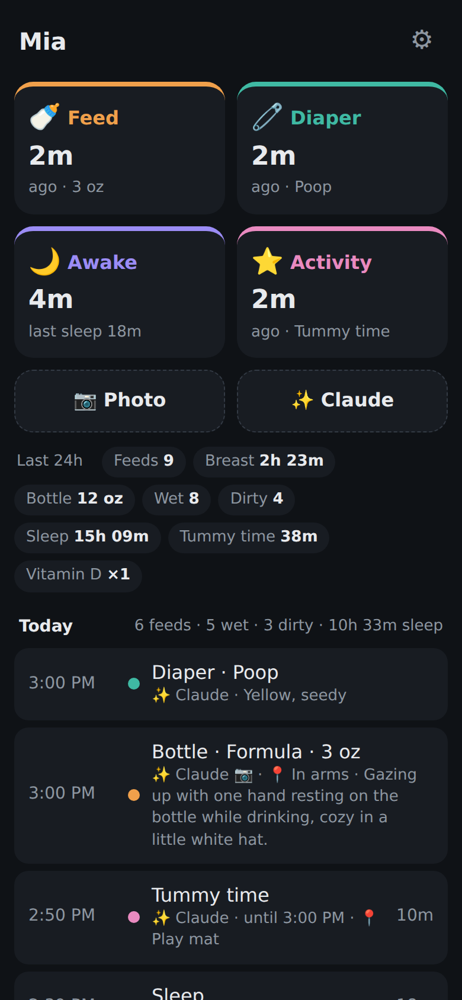
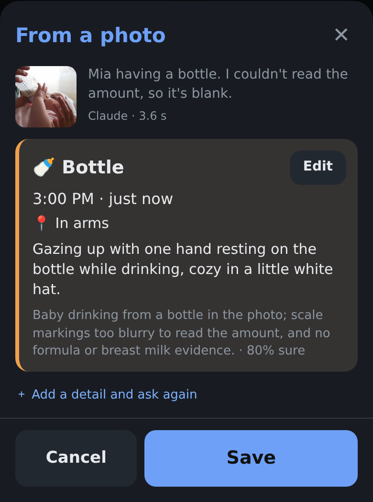
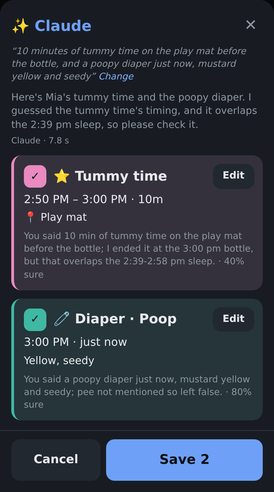
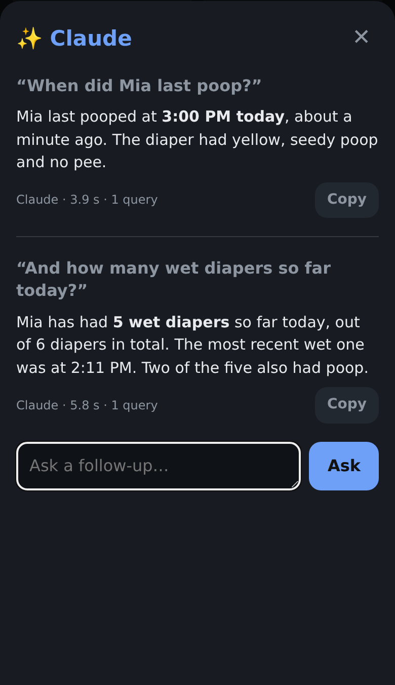

# Baby tracker

A tiny, single-user baby log: feeds, diapers, sleep, plus custom activities (outdoors, bath,
vitamin D, ...). Claude can fill in entries from a photo or a sentence, and answer questions
about the log. One Python server, one HTML page, one SQLite file. Built to be fast to use
one-handed at 3 a.m. and easy for another program to analyze later.

<p align="center">
  
  &nbsp;
  
  &nbsp;
  
  &nbsp;
  
</p>
<p align="center"><sub>Demo data. Photos in the screenshots, all via Wikimedia Commons, resized and shown inside app screenshots:
"<a href="https://commons.wikimedia.org/wiki/File:Baby_and_baby_milk_bottle,_Baby_feeding,_Moscow,_Russia.jpg">Baby and baby milk bottle, Baby feeding, Moscow, Russia</a>"
and "<a href="https://commons.wikimedia.org/wiki/File:Sleeping_baby,_Moscow,_Russia.jpg">Sleeping baby, Moscow, Russia</a>"
by Vyacheslav Argenberg, <a href="https://creativecommons.org/licenses/by/4.0/">CC BY 4.0</a>;
"<a href="https://commons.wikimedia.org/wiki/File:Baby_on_mat.jpg">Baby on mat</a>" by 4455out,
<a href="https://creativecommons.org/licenses/by-sa/4.0/">CC BY-SA 4.0</a>.</sub></p>

- **App URL:** `https://<your-vm>.exe.xyz:8420/` on an [exe.dev](https://exe.dev) VM (private: needs an exe.dev login with access to the VM). Keep it private; don't run `share set-public`.
- **Data:** `data/baby.db` (SQLite). Daily snapshots in `data/backups/` (last 90 kept).
- **Service:** `sudo systemctl status baby-tracker` · logs: `journalctl -u baby-tracker -f`

## Claude features

Three ways to let Claude do the typing. Claude only **proposes**; nothing is saved until you
tap Save on the review screen, and every proposal can be edited there first.

| Button | You | Claude |
|---|---|---|
| **📷 Photo** | Take or pick a photo | Proposes the finished entry: breast or bottle, formula or breast milk, ml read off the bottle's markings, pee/poop with stool color and texture, where the baby is (crib, car seat, play mat, ...), and a note on what the baby is doing. The photo's capture time is the entry time. |
| **✨ Claude → Log it** | Type or dictate (keyboard mic): "4 oz formula at 3, then she slept till 5 and had a poopy diaper" | Proposes all the entries, or edits to existing ones ("she woke up at 4:10", "the last feed was the right side") |
| **✨ Claude → Ask** | "When did she last poop?", "Is she eating more than last week?", "Summary for the 2-month checkup" | Queries the log itself (read-only) and answers, or writes a short report |

More screenshots: [ending a nap from a photo](docs/screenshots/nap.png), [an old photo that needs a
duration](docs/screenshots/duration.png), [fixing an entry by text](docs/screenshots/fix.png), [a summary
for the doctor](docs/screenshots/report.png), [the feed sheet](docs/screenshots/feed.png).

Claude sees the last ~48 h of the log, so it picks the right action: a photo of the baby awake
while a nap timer runs proposes ending the nap at the photo's time; a photo of the baby asleep
starts one. It never invents amounts or durations: if it can't tell how long something lasted,
the review screen asks you. For pale/white, red, or black stool the review screen shows a short
line suggesting a check with your pediatrician (stool-color-card guidance); it makes no other
health judgments.

How it works: the browser shrinks a photo to 1024 px JPEG and reads its capture time →
`POST /api/ai/propose` (photo and/or text) → `propose_ai.py` re-encodes the photo (drops
EXIF/location) and adds the recent log as text → the **Claude Agent SDK** runs the installed,
unmodified **Claude Code** (`~/.local/bin/claude`) with no built-in tools, none of your personal
Claude Code settings, and a JSON schema for the answer → the server checks every proposed entry
with the same validation as a manual entry. `POST /api/ai/ask` → `ask_ai.py` copies the log into
an in-memory database and gives Claude Code one read-only `sql` tool on that copy; it never sees
the database file. Shared plumbing is in `claude_ai.py`.

**Privacy.** Photos are never written to this VM's disk: they live in memory for the few
seconds of the request. Claude Code runs with `--no-session-persistence` (no transcript) and
with telemetry, error reports, and prompt history off. Besides the photo or text, Claude
receives log entries as text: the last ~48 h for proposals, and whatever its queries return for
questions. Saved entries record that Claude proposed them (`data.ai`). The app never reads,
stores, or forwards your Claude login; Claude Code handles its own sign-in.

**On Anthropic's side**, each request is handled like any Claude Code request from your account
([data usage](https://code.claude.com/docs/en/data-usage)): with your subscription it is kept
30 days, or 5 years and used for training if "Help improve Claude" is on (check
[claude.ai/settings/data-privacy-controls](https://claude.ai/settings/data-privacy-controls)).
With an API key (commercial terms) it is kept 30 days and not used for training.

### Setup (one time)

```bash
cd ~/projects/baby-tracker
uv venv .venv --python /usr/bin/python3
# --no-binary skips the SDK's bundled copy of Claude Code (we use the installed one)
uv pip install --python .venv/bin/python --no-binary claude-agent-sdk claude-agent-sdk pillow
claude --version                      # Claude Code must be installed (it is: ~/.local/bin/claude)
```

The service runs `.venv/bin/python server.py` with a clean environment (see
`deploy/baby-tracker.service`). Install or update it with:

```bash
sudo cp deploy/baby-tracker.service /etc/systemd/system/ && sudo systemctl daemon-reload \
  && sudo systemctl enable --now baby-tracker && sudo systemctl restart baby-tracker
```

### Sign in, check, and renew the Claude login

The Claude features use Claude Code's own sign-in for your account (subscription usage).

```bash
claude auth status      # "loggedIn": true, your email, and the plan
claude auth login       # sign in, or renew when the app says "login is missing or expired"
```

`claude auth login` prints a link. Open it on your phone or laptop, sign in to Claude, and if
the browser shows a code, paste it back **into that same VM terminal** at
`Paste code here if prompted`. Claude Code stores the login itself in
`~/.claude/.credentials.json`. Don't paste the code or token anywhere else, and don't put a
`claude setup-token` token in the app's environment: that would hand your subscription
credential to the app, which this setup avoids on purpose. Make sure `ANTHROPIC_API_KEY` is
**not** set for the service, or it overrides the subscription.

### Switch to API credits (no code change)

Claude Code prefers `ANTHROPIC_API_KEY` over the subscription login when it is set.

1. Get credits: on claude.ai, **Settings → Billing → API credits → Link organization**
   (Ultra includes $200/month after 7 days on the plan; credits expire monthly). Check the
   Billing page to see which credits your plan includes (`claude auth status` shows your plan).
2. Create an API key in that organization in the Claude Console (platform.claude.com).
3. Give it to the service only:
   ```bash
   mkdir -p ~/.config/baby-tracker
   install -m 600 /dev/null ~/.config/baby-tracker/env   # owner-only file
   nano ~/.config/baby-tracker/env                      # add one line: ANTHROPIC_API_KEY=sk-ant-...
   sudo systemctl restart baby-tracker
   ```
   (Editing the file keeps the key out of your shell history.)
   To go back to the subscription, delete that line (or file) and restart.

Optional knobs (same env file): `BABY_AI_MODEL` for photo/text proposals (default `sonnet`;
the old `BABY_PHOTO_MODEL` still works), `BABY_AI_EFFORT` (default `low` for the default
model; `default` leaves it to Claude Code), `BABY_AI_TIMEOUT` (seconds, default 45),
`BABY_ASK_MODEL` for questions (default `sonnet`), `BABY_ASK_TIMEOUT` (seconds, default 120).
Sonnet at low effort was the most accurate and fastest of the configurations tested: ~3 s for a
photo, ~5 s for a sentence with several events.

### Troubleshooting

| Message in the app | Fix |
|---|---|
| Claude login is missing or expired | `claude auth login` on the VM (above) |
| Claude features aren't set up on the server | Run the server with `.venv/bin/python` (Setup above) |
| Claude didn't answer within 45 s (or 120 s) | Retry; check `journalctl -u baby-tracker` |
| Claude usage limit reached | Wait for the plan limit to reset, or switch to API credits |

## Files

| Path | What |
|---|---|
| `server.py` | HTTP server + JSON API + SQLite storage + daily backups (stdlib only) |
| `claude_ai.py` | Shared Claude plumbing: runs Claude Code via the Agent SDK with no tools or personal settings (needs `.venv`) |
| `propose_ai.py` | Photo and/or text → proposed entries (prompt, answer schema, log context, local time → UTC) |
| `ask_ai.py` | Questions about the log: in-memory copy of the log + one read-only `sql` tool |
| `tests/` | `python -m unittest discover -s tests` (no Claude calls) |
| `static/index.html` | The whole UI (vanilla JS, no build step) |
| `.venv/` | Python env with `claude-agent-sdk` and `pillow` (only the Claude features need it) |
| `deploy/baby-tracker.service` | systemd unit (installed to `/etc/systemd/system/`) |
| `data/baby.db` | The data. Back this up. |

## Data model (for analysis)

One table, `events`. Every row is one thing that happened.

| Column | Type | Meaning |
|---|---|---|
| `id` | int | Primary key |
| `kind` | text | `feed`, `diaper`, `sleep`, or `activity` |
| `start_at` | text | UTC, `YYYY-MM-DDTHH:MM:SSZ` |
| `end_at` | text / NULL | UTC. **NULL = timer still running.** Equal to `start_at` for point events (diapers, bottle feeds, activities logged as a single moment). |
| `data` | JSON text | Details per kind (below) |
| `note` | text | Free text, may be empty |
| `tz` | text | IANA time zone of the device that logged it (e.g. `America/Los_Angeles`). Use it to get local time of day. |
| `logged_by` | text / NULL | exe.dev email of whoever logged it |
| `created_at`, `updated_at` | text | UTC bookkeeping |

`data` by kind:

| kind | data | duration |
|---|---|---|
| `feed` (breast) | `{"method":"breast","side":"left"\|"right"\|"both"}` | `end_at - start_at` |
| `feed` (bottle) | `{"method":"bottle","milk":"breastmilk"\|"formula","amount_ml":90}` (`amount_ml` may be null) | none (point event) |
| `diaper` | `{"pee":true,"poop":true,"color":"yellow","texture":"seedy"}` (both false = dry; `color`/`texture` optional, only with poop) | none (point event) |
| `sleep` | `{}` | `end_at - start_at` |
| `activity` | `{"name":"Outdoors"}` (free text, trimmed, max 60 chars) | `end_at - start_at`; none if `end_at == start_at` |

Conventions worth knowing:

- **Amounts are always stored in ml**, even if the UI shows oz (1 oz = 29.5735 ml).
- **One feeding session can be several rows.** "Switch side" ends the left row and starts a
  right row. The UI merges feed rows that are less than 15 minutes apart into one session
  when counting feeds. Do the same when computing "feeds per day" or "time between feeds".
- Time between feeds is conventionally measured **start to start**.
- Sleep can cross midnight; split by day boundaries (in local time) when summing per day.
- Rows can be edited or deleted after the fact, so re-read rather than append-sync.
- Activity names are free text typed by the user. The UI reuses the existing spelling when a
  typed name matches one case-insensitively, but group by `lower(name)` to be safe.
- Optional keys on any kind: `place` (where it happened, e.g. "crib", "car seat"; max 40 chars)
  and `ai` (below). Stool `color` is one of `yellow` (incl. mustard), `orange`, `green`,
  `brown`, `black`, `red`, `pale`; `texture` one of `watery`, `loose`, `seedy`, `soft`,
  `pasty`, `formed`, `hard`. Each kind keeps only its own keys; others are dropped on save.
- Entries saved from a Claude proposal carry
  `data.ai = {"source": "photo"|"text"|"photo+text", "model": "sonnet", "confidence": 0.9, "edited": false}`.
  `edited` is true when you changed the proposal before saving, so `edited` rates Claude's accuracy.
- Older entries from the first photo feature carry `data.photo = {"suggested": "feeding", "confidence": 0.97}`
  (one of `feeding|sleeping|playing|diaper_change|tummy_time|bath|other`).

### Quick queries

```bash
sqlite3 -header -column data/baby.db \
  "SELECT kind, count(*) FROM events GROUP BY kind"

# Diapers per local day
sqlite3 -header -column data/baby.db "
  SELECT date(start_at, 'localtime') AS day,
         sum(json_extract(data,'$.pee')) AS wet,
         sum(json_extract(data,'$.poop')) AS dirty
  FROM events WHERE kind='diaper' GROUP BY day ORDER BY day"
```

(`'localtime'` uses the VM's zone, which is UTC. For true local time use the `tz` column,
e.g. in pandas below.)

```python
import json, sqlite3, pandas as pd
df = pd.read_sql("SELECT * FROM events WHERE end_at IS NOT NULL", sqlite3.connect("data/baby.db"))
df["data"] = df["data"].map(json.loads)
df = df.join(pd.json_normalize(df["data"]))
for c in ("start_at", "end_at"):
    df[c] = pd.to_datetime(df[c], utc=True).dt.tz_convert(df["tz"].dropna().iloc[-1])
df["minutes"] = (df.end_at - df.start_at).dt.total_seconds() / 60
```

Read the live file with SQLite (not by copying it mid-write). To grab a consistent copy:
`sqlite3 data/baby.db ".backup /path/to/copy.db"`, or use a file from `data/backups/`.

## HTTP API

All JSON. Writes need `Content-Type: application/json`.

| Method & path | Does |
|---|---|
| `GET /api/events?since=ISO&until=ISO` | List, newest first. `since` also returns rows that ended after it or are still running. |
| `POST /api/events` | Create. Body: `kind`, `start_at` (default now), `end_at`, `data`, `note`, `tz` |
| `PATCH /api/events/{id}` | Update any of `start_at`, `end_at` (null = running again), `data`, `note` |
| `DELETE /api/events/{id}` | Delete |
| `GET /api/activity-names` | Distinct activity names, most recently used first |
| `POST /api/ai/propose` | Body: `text` and/or `image` (base64 JPEG), `photo_taken_at`, `tz`, `baby_name`, `unit` (max 8 MB). Returns `{source, message, proposals, elapsed_ms, model}`; each proposal is `{op:"create", event}` (ready for `POST /api/events`) or `{op:"update", id, patch, before, after}` (ready for `PATCH`), plus `needs`, `confidence`, `why`. Saves nothing. |
| `POST /api/ai/ask` | Body: `question`, `history` (`[{q, a}]`, last 6), `tz`, `baby_name`, `unit`. Returns `{answer (markdown), elapsed_ms, model, queries}`. Read-only. |
| `GET /api/export.csv` / `GET /api/export.json` | Everything, flattened one row per event, with `start_local`, `end_local`, `duration_min`, activity `name`, `place`, stool `color`/`texture`, `ai_source`/`ai_model`/`ai_confidence`/`ai_edited`, `photo_suggested`, `photo_confidence` |

## Running

```bash
.venv/bin/python server.py            # PORT=8420 HOST=127.0.0.1 BABY_DATA_DIR=./data by default
sudo systemctl restart baby-tracker   # after editing code
```

`python3 server.py` (no venv) also works; everything except the Claude features is stdlib only.
