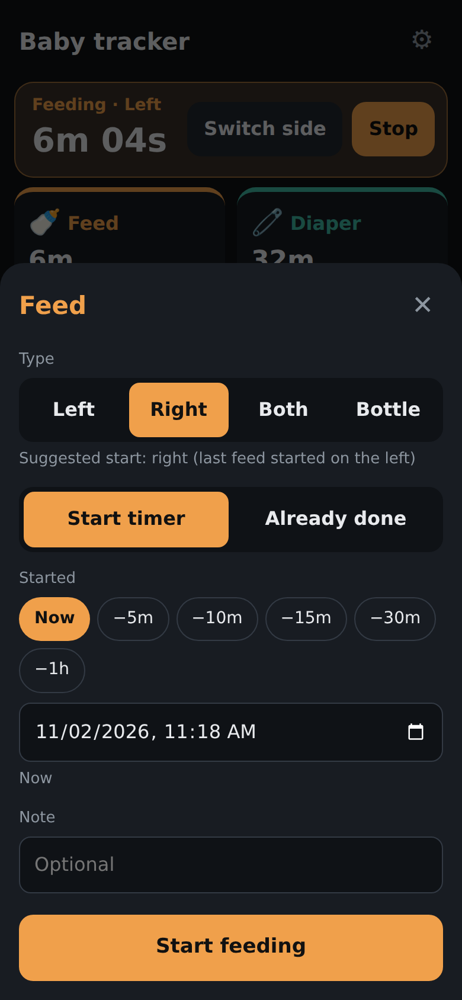

# Baby tracker

A tiny, single-user baby log: feeds, diapers, sleep, plus custom activities (outdoors, bath,
vitamin D, ...), and logging from a photo with Claude. One Python server, one HTML page, one
SQLite file. Built to be fast to use one-handed at 3 a.m. and easy for another program to
analyze later.

<p align="center">
  
  &nbsp;
  
  &nbsp;
  
</p>
<p align="center"><sub>Demo data. Photo in the middle screenshot: "Baby and baby milk bottle, Baby feeding, Moscow, Russia"
by Vyacheslav Argenberg, <a href="https://creativecommons.org/licenses/by/4.0/">CC BY 4.0</a>, via
<a href="https://commons.wikimedia.org/wiki/File:Baby_and_baby_milk_bottle,_Baby_feeding,_Moscow,_Russia.jpg">Wikimedia Commons</a>
(resized, shown inside an app screenshot).</sub></p>

- **App URL:** `https://<your-vm>.exe.xyz:8420/` on an [exe.dev](https://exe.dev) VM (private: needs an exe.dev login with access to the VM). Keep it private; don't run `share set-public`.
- **Data:** `data/baby.db` (SQLite). Daily snapshots in `data/backups/` (last 90 kept).
- **Service:** `sudo systemctl status baby-tracker` · logs: `journalctl -u baby-tracker -f`

## Log from a photo (Claude)

Tap **📷 Log from a photo**, take or pick a photo, and Claude suggests one of: feeding,
sleeping, playing, diaper change, tummy time, bath, other. Tap **Next** to open the normal
entry screen prefilled; nothing is saved until you confirm there. Typical answer: 3–5 s.

How it works: the browser shrinks the photo to 1024 px JPEG → `POST /api/photo/classify` →
`photo_ai.py` re-encodes it (drops EXIF/location) → the **Claude Agent SDK** runs the
installed, unmodified **Claude Code** (`~/.local/bin/claude`) with model `haiku`, one turn,
no tools, a classifier system prompt, and none of your personal Claude Code settings →
strict JSON `{activity, confidence, notes}`, validated, falling back to `other`.

**Privacy.** Photos are never written to this VM's disk: they live in memory for the few
seconds of the request. Claude Code runs with `--no-session-persistence` (no transcript) and
with telemetry, error reports, and prompt history off. Saved entries only record what Claude
suggested (`data.photo`); for "Other", Claude's short description is prefilled into the note,
which you can clear before saving. The app never reads, stores, or forwards your Claude login;
Claude Code handles its own sign-in.

**On Anthropic's side**, each photo is handled like any Claude Code request from your account
([data usage](https://code.claude.com/docs/en/data-usage)): with your subscription it is kept
30 days, or 5 years and used for training if "Help improve Claude" is on (check
[claude.ai/settings/data-privacy-controls](https://claude.ai/settings/data-privacy-controls)).
With an API key (commercial terms) it is kept 30 days and not used for training.

### Setup (one time)

```bash
cd ~/projects/baby-tracker
uv venv .venv --python /usr/bin/python3
# --no-binary skips the SDK's bundled copy of Claude Code (we use the installed one)
uv pip install --python .venv/bin/python --no-binary claude-agent-sdk claude-agent-sdk pillow
claude --version                      # Claude Code must be installed (it is: ~/.local/bin/claude)
```

The service runs `.venv/bin/python server.py` with a clean environment (see
`deploy/baby-tracker.service`). Install or update it with:

```bash
sudo cp deploy/baby-tracker.service /etc/systemd/system/ && sudo systemctl daemon-reload \
  && sudo systemctl enable --now baby-tracker && sudo systemctl restart baby-tracker
```

### Sign in, check, and renew the Claude login

The classifier uses Claude Code's own sign-in for your account (subscription usage).

```bash
claude auth status      # "loggedIn": true, your email, and the plan
claude auth login       # sign in, or renew when photos say "login is missing or expired"
```

`claude auth login` prints a link. Open it on your phone or laptop, sign in to Claude, and if
the browser shows a code, paste it back **into that same VM terminal** at
`Paste code here if prompted`. Claude Code stores the login itself in
`~/.claude/.credentials.json`. Don't paste the code or token anywhere else, and don't put a
`claude setup-token` token in the app's environment: that would hand your subscription
credential to the app, which this setup avoids on purpose. Make sure `ANTHROPIC_API_KEY` is
**not** set for the service, or it overrides the subscription.

### Switch to API credits (no code change)

Claude Code prefers `ANTHROPIC_API_KEY` over the subscription login when it is set.

1. Get credits: on claude.ai, **Settings → Billing → API credits → Link organization**
   (Ultra includes $200/month after 7 days on the plan; credits expire monthly). Check the
   Billing page to see which credits your plan includes (`claude auth status` shows your plan).
2. Create an API key in that organization in the Claude Console (platform.claude.com).
3. Give it to the service only:
   ```bash
   mkdir -p ~/.config/baby-tracker
   install -m 600 /dev/null ~/.config/baby-tracker/env   # owner-only file
   nano ~/.config/baby-tracker/env                      # add one line: ANTHROPIC_API_KEY=sk-ant-...
   sudo systemctl restart baby-tracker
   ```
   (Editing the file keeps the key out of your shell history.)
   To go back to the subscription, delete that line (or file) and restart.

Optional knobs (same env file): `BABY_PHOTO_MODEL` (default `haiku`),
`BABY_PHOTO_TIMEOUT` (seconds, default 30).

### Troubleshooting

| Message in the app | Fix |
|---|---|
| Claude login is missing or expired | `claude auth login` on the VM (above) |
| Photo AI isn't set up on the server | Run the server with `.venv/bin/python` (Setup above) |
| Claude didn't answer within 30 s | Retry; check `journalctl -u baby-tracker` |
| Claude usage limit reached | Wait for the plan limit to reset, or switch to API credits |

## Files

| Path | What |
|---|---|
| `server.py` | HTTP server + JSON API + SQLite storage + daily backups (stdlib only) |
| `photo_ai.py` | Photo → activity suggestion via the Claude Agent SDK (needs `.venv`) |
| `static/index.html` | The whole UI (vanilla JS, no build step) |
| `.venv/` | Python env with `claude-agent-sdk` and `pillow` (not needed for the core tracker) |
| `deploy/baby-tracker.service` | systemd unit (installed to `/etc/systemd/system/`) |
| `data/baby.db` | The data. Back this up. |

## Data model (for analysis)

One table, `events`. Every row is one thing that happened.

| Column | Type | Meaning |
|---|---|---|
| `id` | int | Primary key |
| `kind` | text | `feed`, `diaper`, `sleep`, or `activity` |
| `start_at` | text | UTC, `YYYY-MM-DDTHH:MM:SSZ` |
| `end_at` | text / NULL | UTC. **NULL = timer still running.** Equal to `start_at` for point events (diapers, bottle feeds, activities logged as a single moment). |
| `data` | JSON text | Details per kind (below) |
| `note` | text | Free text, may be empty |
| `tz` | text | IANA time zone of the device that logged it (e.g. `America/Los_Angeles`). Use it to get local time of day. |
| `logged_by` | text / NULL | exe.dev email of whoever logged it |
| `created_at`, `updated_at` | text | UTC bookkeeping |

`data` by kind:

| kind | data | duration |
|---|---|---|
| `feed` (breast) | `{"method":"breast","side":"left"\|"right"\|"both"}` | `end_at - start_at` |
| `feed` (bottle) | `{"method":"bottle","milk":"breastmilk"\|"formula","amount_ml":90}` (`amount_ml` may be null) | none (point event) |
| `diaper` | `{"pee":true,"poop":false}` (both false = dry) | none (point event) |
| `sleep` | `{}` | `end_at - start_at` |
| `activity` | `{"name":"Outdoors"}` (free text, trimmed, max 60 chars) | `end_at - start_at`; none if `end_at == start_at` |

Conventions worth knowing:

- **Amounts are always stored in ml**, even if the UI shows oz (1 oz = 29.5735 ml).
- **One feeding session can be several rows.** "Switch side" ends the left row and starts a
  right row. The UI merges feed rows that are less than 15 minutes apart into one session
  when counting feeds. Do the same when computing "feeds per day" or "time between feeds".
- Time between feeds is conventionally measured **start to start**.
- Sleep can cross midnight; split by day boundaries (in local time) when summing per day.
- Rows can be edited or deleted after the fact, so re-read rather than append-sync.
- Activity names are free text typed by the user. The UI reuses the existing spelling when a
  typed name matches one case-insensitively, but group by `lower(name)` to be safe.
- Entries logged from a photo carry `data.photo = {"suggested": "feeding", "confidence": 0.97}`:
  what Claude suggested (`feeding|sleeping|playing|diaper_change|tummy_time|bath|other`). The
  row's `kind`/`data` is what you confirmed, so comparing the two measures Claude's accuracy.

### Quick queries

```bash
sqlite3 -header -column data/baby.db \
  "SELECT kind, count(*) FROM events GROUP BY kind"

# Diapers per local day
sqlite3 -header -column data/baby.db "
  SELECT date(start_at, 'localtime') AS day,
         sum(json_extract(data,'$.pee')) AS wet,
         sum(json_extract(data,'$.poop')) AS dirty
  FROM events WHERE kind='diaper' GROUP BY day ORDER BY day"
```

(`'localtime'` uses the VM's zone, which is UTC. For true local time use the `tz` column,
e.g. in pandas below.)

```python
import json, sqlite3, pandas as pd
df = pd.read_sql("SELECT * FROM events WHERE end_at IS NOT NULL", sqlite3.connect("data/baby.db"))
df["data"] = df["data"].map(json.loads)
df = df.join(pd.json_normalize(df["data"]))
for c in ("start_at", "end_at"):
    df[c] = pd.to_datetime(df[c], utc=True).dt.tz_convert(df["tz"].dropna().iloc[-1])
df["minutes"] = (df.end_at - df.start_at).dt.total_seconds() / 60
```

Read the live file with SQLite (not by copying it mid-write). To grab a consistent copy:
`sqlite3 data/baby.db ".backup /path/to/copy.db"`, or use a file from `data/backups/`.

## HTTP API

All JSON. Writes need `Content-Type: application/json`.

| Method & path | Does |
|---|---|
| `GET /api/events?since=ISO&until=ISO` | List, newest first. `since` also returns rows that ended after it or are still running. |
| `POST /api/events` | Create. Body: `kind`, `start_at` (default now), `end_at`, `data`, `note`, `tz` |
| `PATCH /api/events/{id}` | Update any of `start_at`, `end_at` (null = running again), `data`, `note` |
| `DELETE /api/events/{id}` | Delete |
| `GET /api/activity-names` | Distinct activity names, most recently used first |
| `POST /api/photo/classify` | Body: raw image bytes with `Content-Type: image/*` (max 15 MB). Returns `{activity, confidence, notes, parsed, elapsed_ms, model}`. Saves nothing. |
| `GET /api/export.csv` / `GET /api/export.json` | Everything, flattened one row per event, with `start_local`, `duration_min`, activity `name`, `photo_suggested`, `photo_confidence` |

## Running

```bash
.venv/bin/python server.py            # PORT=8420 HOST=127.0.0.1 BABY_DATA_DIR=./data by default
sudo systemctl restart baby-tracker   # after editing code
```

`python3 server.py` (no venv) also works; everything except photo logging is stdlib only.
